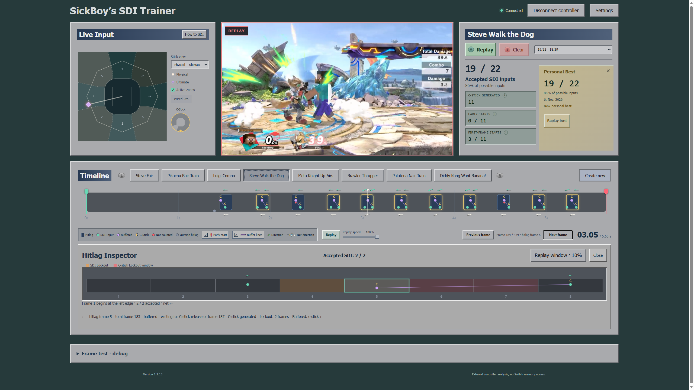

# SickBoy’s SDI Trainer

Practise Smash Directional Influence (SDI) against recorded moves and combos in Super Smash Bros. Ultimate. The trainer aims to simulate Ultimate’s SDI rules as closely as possible and shows how your inputs register frame by frame.

**[Download and setup for Windows](#download-for-windows)**

## Download for Windows

1. Open [Releases](https://github.com/SickBoyPog/sdi-trainer/releases) and download the Windows ZIP from the latest release.
2. Extract the ZIP and follow the [Windows setup guide](INSTALL-WINDOWS.txt) to prepare your controller and start the trainer.

The trainer supports 64-bit Windows 10 and 11, a GameCube controller through a compatible USB adapter, and the original Nintendo Switch Pro Controller over USB.

## What you can do

- **Practise SDI against moves and combos.** Review accepted, buffered, and missed inputs on the timeline. Open the Hitlag Inspector to step through an individual window.
- **Learn SDI and C-Stick timing.** Open **How to SDI** and try the inputs in the Live Input viewer.
- **Make your own preset.** Click **Create new**, drop in a clip, and mark hitlag windows and optional DI frames. Use 60 FPS footage when possible. See the [preset file guide](presets/README.md) for sharing or editing preset folders.
- **Play DWB.** Move with SDI and collect bananas in Burst or Endurance mode.

## Recommended DWB asset pack

**For the best DWB experience, install the DWB asset pack.** The bundled sprites and sounds are enough to play, but most character animations use simplified loops. The pack adds the full character animations and sound effects.

Copy the pack’s `assets` folder into the trainer folder beside `Start-SDI-Trainer.cmd`. Choose **Replace the files in the destination**, then refresh the trainer with **Ctrl+F5**. To restore the bundled art and audio, copy `assets` from a fresh extraction of the Windows ZIP. See the [bundled asset credits](assets/dwb/SOURCE.md).

## Feedback

Send feedback on responsiveness, bugs, clarity, and practice value to **SickBoy** on Discord. For a bug report, include the trainer version from the footer, your browser, your controller or adapter, and the steps to reproduce it.

Some simulation details are approximate. See [Known limitations](KNOWN-LIMITATIONS.md).

## License

The trainer’s original source code is available under the [MIT License](LICENSE). Sprites, sounds, fonts, and gameplay footage are outside the code license. See the [DWB asset credits](assets/dwb/SOURCE.md) for the bundled DWB assets.
